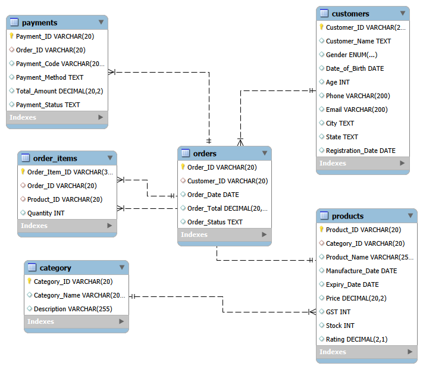
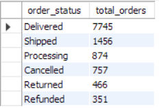
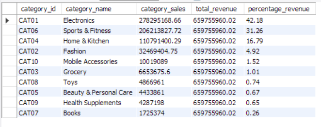
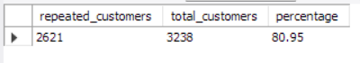
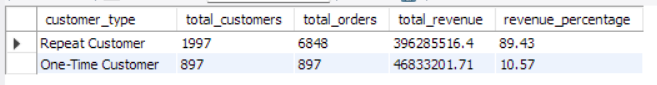
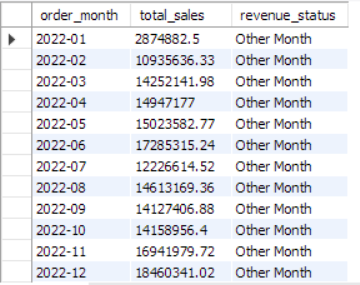
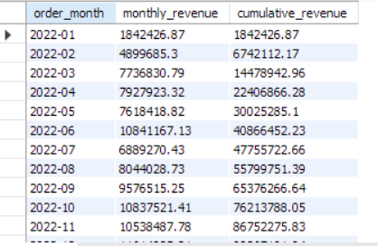

# 🛒 ShopKart SQL Business Analysis

This is my first SQL portfolio project. I took an e-commerce database for an online store called ShopKart (3,238 customers, 1,669 products and 11,649 orders) and answered 28 business questions about it using MySQL. For every result I also wrote what it means for the business.

---

## 📚 Table of Contents
- Business Problem
- Overview
- Business Questions
- Project Structure
- Tech Stack
- Database Design
- Data
- Key Metrics
- Key Insights
- Recommendations
- Result Screenshots
- Presentation
- Things to Know About the Data
- How to Run
- Objective
- About Me

---

## 🎯 Business Problem

ShopKart is an online store. Its management wants to understand how the business is doing and where it can improve. In this project I tried to:

- Analyse overall sales and revenue trends.
- Find the top performing products and categories.
- Understand how customers buy and whether they come back.
- Look at order cancellations and payment performance.
- Find inventory and business improvement opportunities.

From the analysis I found **3 main business problems**:

| # | Problem | Based on |
|---|---|---|
| 1 | **Inventory Management**: some products have high stock but low sales, while popular products may have low stock | Q17, Q25 |
| 2 | **Customer Retention**: some customers buy only once, and others have not bought for a long time | Q14, Q23, Q24, Q27 |
| 3 | **Order & Payment Issues**: some orders are cancelled, returned or refunded, which affects revenue | Q3, Q6, Q15, Q26 |

The solutions for these are in the [Recommendations](#-recommendations) section.

---

## 📌 Overview

**ShopKart** is a practice e-commerce database (an online store with customers, products, orders and payments). This is my first SQL portfolio project. I used **MySQL** to answer **28 business questions** about sales, customers, products, orders and payments, and turned the results into key insights and recommendations for the business.

The data has **3,238 customers**, **1,669 products** and **11,649 orders**, from **14 January 2022 to 16 February 2026**. The raw data files are in the [data](data/) folder (see the [Data](#-data) section).

---

## 🧩 Business Questions

The 28 questions are in three levels. All the queries are in [SQL/02_SHOPKART_Analysis.sql](SQL/02_SHOPKART_Analysis.sql).

**Basic (Q1 to Q8)**
Database size, total revenue, orders by status, most expensive products, products per category, payment methods, orders by city, stock levels.

**Intermediate (Q9 to Q18)**
Monthly revenue, revenue share of each category, top customers, revenue vs quantity sold, average order value, repeat customers, cancellations by payment method, high revenue but low order states, high stock but low sales products, ratings vs sales.

**Advanced (Q19 to Q28)**
Cumulative revenue, month on month growth, top 3 products in each category, customer contribution to revenue, churn risk, customer segments, high revenue but low stock categories, cancellations by state, repeat vs one-time customers, seasonality and year on year growth.

---

## 🗂️ Project Structure

```bash
shopkart-sql-analysis/
│
├── data/                        # Raw data files (one file for each table)
│   └── (Category, Customers, Products, Orders, Order_Items, Payments)
│
├── SQL/                         # Database schema and all 28 queries
│   ├── 01_Database_Schema.sql
│   └── 02_SHOPKART_Analysis.sql
│
├── images/                      # ERD, charts and result screenshots
│
├── presentation/                # Project slides
│   └── ShopKart_Analysis.pdf
│
├── insights.md                  # Key insights, problems and solutions
└── README.md
```

---

## 🛠️ Tech Stack

| Tool | Purpose |
|---|---|
| MySQL | Database, queries and analysis |
| MySQL Workbench | Writing queries and making the ERD |
| Canva | Project presentation |
| Markdown | Documentation |

**SQL concepts used:** joins (inner, left, cross), CTEs, subqueries, window functions (`LAG`, `DENSE_RANK`, `SUM() OVER`), `CASE WHEN`, date functions, aggregate functions, percentage calculations.

---

## 🧠 Database Design

The database has six tables connected through primary and foreign keys.

| Table | What it has |
|---|---|
| Customers | 3,238 customers with city, state, age and registration date |
| Category | 10 product categories |
| Products | 1,669 products with price, GST, stock and rating |
| Orders | 11,649 orders with date, total and status |
| Order_Items | which products were in each order, and how many |
| Payments | payment method, amount and status |

### 📌 ER Diagram



---

## 📂 Data

The [data](data/) folder has the raw data of the ShopKart database. There is one file for each of the six tables, in the same structure as the schema in `SQL/01_Database_Schema.sql`.

| Data file (table) | Records | What it has |
|---|---|---|
| Category | 10 | Product categories |
| Customers | 3,238 | Customer details: city, state, age, registration date |
| Products | 1,669 | Product details: category, price, GST, stock, rating |
| Orders | 11,649 | Order date, order total and order status |
| Order_Items | 22,913 | Which products were in each order, and the quantity |
| Payments | 11,649 | Payment method, amount and payment status |

**About the data:**
- It is a practice (sample) e-commerce dataset, not real company data.
- Time period: 14 January 2022 to 16 February 2026.
- The tables are linked with primary and foreign keys, so they must be loaded in this order: Category, Customers, Products, Orders, Order_Items, Payments.
- A few product names have broken characters because of the .txt import(see the notes below).

---

## 📌 Key Metrics

| Metric | Value |
|---|---|
| Total customers | 3,238 |
| Total orders | 11,649 |
| Delivered orders | 7,745 (66.5%) |
| Cancelled, returned or refunded orders | 1,574 (13.5%) |
| Revenue from completed payments | about 58.57 crore |
| Revenue from delivered orders | about 44.31 crore |
| Average delivered order value | about 57,000 |
| Customers with more than one order | 80.95% |
| Revenue from repeat customers | 89.43% |

---

## 🔍 Key Insights

1. About 2 out of 3 orders were delivered. Around 1 in 7 orders (13.5%) was cancelled, returned or refunded (Q3).
2. Three categories, Electronics, Sports & Fitness and Home & Kitchen, bring in about 90% of the revenue. Grocery has the most products but only 1% of the revenue (Q10).
3. One Whirlpool camera earned about 1.59 crore. That is more than each of six whole categories (Q21).
4. About 4 out of 5 customers ordered more than once, and these repeat customers bring in about 89% of the delivered revenue (Q14, Q27).
5. Grocery holds about 24% of all the stock but earns only 1% of the revenue. 432 products have a lot of stock but low sales (Q17, Q25).
6. Delivered revenue was about 10.9 crore in 2023, 11.3 crore in 2024 and 11.2 crore in 2025, so growth has slowed down (Q19).

The findings are explained in simple words in [insights.md](insights.md).

---

## 💡 Recommendations

### 1. Inventory Management
**Problem:** Some products have high stock but low sales, while popular products may have low stock.

**Solution:**
- Reduce the stock of products with low sales.
- Restock the products that sell more.
- Offer discounts on slow moving products.

*Based on Q17 and Q25*

### 2. Customer Retention
**Problem:** Some customers purchase only once, while others have not purchased for a long time.

**Solution:**
- Give special offers to inactive customers.
- Reward customers who purchase regularly.
- Send personalised offers to customers.

*Based on Q14, Q23, Q24 and Q27*

### 3. Order & Payment Issues
**Problem:** Some orders are cancelled or refunded, which can affect business revenue.

**Solution:**
- Find the reasons behind cancellations and refunds.
- Identify the payment methods with more failed orders.
- Improve the payment and order process.

*Based on Q3, Q6, Q15 and Q26*

These are the same problems and solutions as in my [presentation](presentation/ShopKart_Analysis.pdf). The full findings behind them are in [insights.md](insights.md).

---

## 🖼️ Result Screenshots

**Q3: Orders by status**



**Q10: Revenue share by category**



**Q14: Customers with more than one order**



**Q27: Repeat vs one-time customer revenue**



**Q9: Monthly revenue**



**Q19: Cumulative revenue**



More result screenshots ( Q2, Q15, Q16, Q24, Q25, Q26) are in the `images` folder.

---

## 🎤 Presentation

The project slides are here: [presentation/ShopKart_Analysis.pdf](presentation/ShopKart_Analysis.pdf)

---

## ⚠️ Things to Know About the Data

- January 2022 (data starts on 14 Jan) and February 2026 (data ends on 16 Feb) are not full months. Growth numbers that involve them, like +628% for Jan 2023 or -93.78% for Feb 2026, should be ignored.
- I used three different meanings of revenue, so the totals do not match:
  - Completed payments, in Q2 (58.57 crore)
  - Delivered orders (`order_total`), in Q13, Q19, Q20, Q22, Q27 and Q28 (about 44.3 crore)
  - Price x quantity for all orders, before GST, in Q10, Q12, Q17, Q18, Q21 and Q25 (65.98 crore)
- Q9, Q11 and Q16 use payment amounts.
- A cancelled, returned or refunded order is counted as unsuccessful.
- For churn (Q23) I measured from the last order date in the data (16 Feb 2026), not from today. Active means 30 days or less, At Risk means 31 to 90 days and High Risk means more than 90 days. Customers in this data buy only once or twice a year, so most of them end up as High Risk.
- A few product names have broken characters because of the .txt import.
- The ERD is made from the schema in `SQL/01_Database_Schema.sql`.

---

## ▶️ How to Run

1. Run `SQL/01_Database_Schema.sql` in MySQL Workbench to create the database and tables.
2. Load the six data files from the [data](data/) folder into the tables in this order: Category, Customers, Products, Orders, Order_Items, Payments.
3. Run the queries in `SQL/02_SHOPKART_Analysis.sql` one by one.

---

## 🎯 Objective

To practise SQL on a realistic e-commerce database and to learn how to turn query results into business insights and suggestions.

---

## ✍️ About Me

I am **Devanshi**. I am learning data analytics and this is my first SQL project.

- GitHub: [devanshii22-oss](https://github.com/devanshii22-oss)
- LinkedIn: [devanshi-verma06](https://www.linkedin.com/in/devanshi-verma06)
